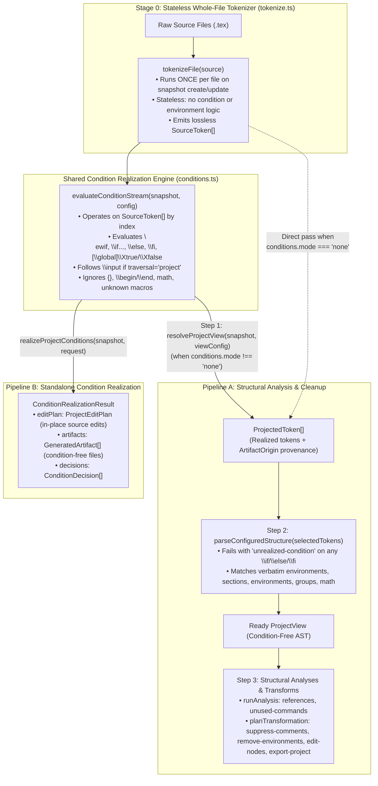

# PrepTeX Core (`@preptex/core`) Implementation Plan: Single Stateless Tokenizer, Standalone Condition Realizer, and Condition-Free Structural Pipeline

Status: **Proposed Backend Implementation Specification**
Prepared: 2026-10-16
Baseline: `@preptex/core@0.3.0`

---

## 1. Goal and Core Architectural Invariants

PrepTeX processes academic LaTeX projects using **two separate, composable pipelines** built on top of **one stateless whole-file tokenizer**:

1. **Stage 0 — Whole-File Stateless Tokenizer (`tokenizeFile`)**:
   - Scans a `.tex` file once from index `0` to `source.length` and produces a flat, lossless array of primitive tokens (`SourceToken[]`).
   - Completely unaware of conditions, `\input` files, or environments.
2. **Pipeline B — Standalone Condition Realization (`realizeProjectConditions`)**:
   - Consumes `SourceToken[]` and evaluates **only** conditional constructs (`\newif`, `\if...`, `\else`, `\fi`, `\Xtrue`, `\Xfalse`, `\global\Xtrue`, `\global\Xfalse`, and optional `\input` traversal to propagate condition state across files).
   - **Ignores all other LaTeX constructs** (brace groups `{}`, `\begin`/`\end` environments, math `$`, sections, and custom macros).
   - Outputs both an in-place `ProjectEditPlan` (removing condition commands and inactive branches) and realized condition-free `GeneratedArtifact[]` files.
3. **Pipeline A — Structural View, Analytics, and Transformations (`resolveProjectView` $\rightarrow$ `parseConfiguredStructure` $\rightarrow$ `runAnalysis` / `planTransformation`)**:
   - **Step 1 (View Preprocessor)**: Reuses the Condition Realizer (plus `\input` expansion policy) to produce a **condition-free `ProjectedToken[]` stream** with `ArtifactOrigin` provenance back to the original source files.
   - **Step 2 (Condition-Free AST Parser)**: Builds the structural AST (`ConfiguredNode`: `root | section | environment | group | math | verbatim | token`) from the token stream. **Raises an explicit `'unrealized-condition'` error if any condition token is encountered.**
   - **Step 3 (Analytics & Structural Transforms)**: Runs `references`, `unused-commands`, `suppress-comments`, `remove-environments`, `edit-nodes`, and `export-project` exclusively on the realized view.

### The 6 Non-Negotiable Invariants

| ID        | Invariant                                           | Verification Rule                                                                                                                                                                                                                                                                 |
| :-------- | :-------------------------------------------------- | :-------------------------------------------------------------------------------------------------------------------------------------------------------------------------------------------------------------------------------------------------------------------------------- |
| **INV-1** | **Single Stateless Tokenizer**                      | `tokenizeFile(source)` runs **once per file** when creating/updating a `ProjectSnapshot`. It takes only `(source: string)` and emits primitive tokens (`comment`, `space`, `command`, `open`, `close`, `math`, `text`).                                                           |
| **INV-2** | **Lossless Token Stream & Zero Re-Lexing**          | `file.tokens.map(t => t.value).join('') === file.source` for every file. No downstream module (`scan`, `conditions`, `view`, `structure`, `transformation`) may call a character-level lexer on raw source strings.                                                               |
| **INV-3** | **Condition Realizer Ignores Non-Condition Syntax** | `realizeProjectConditions` succeeds (`status: 'ready'`) even when active or inactive branches contain unbalanced `{`, mismatched `\begin{foo}...\end{bar}`, unclosed `$`, or unknown macros `\mycmd{...}`.                                                                        |
| **INV-4** | **AST Parser Rejects Unrealized Conditions**        | `parseConfiguredStructure` expects **zero** condition tokens. Encountering `\newif`, `\if...`, `\else`, `\fi`, or a declared boolean setter `\Xtrue`/`\Xfalse` outside comments/verbatim immediately stops with `status: 'blocked'` and `reason.code === 'unrealized-condition'`. |
| **INV-5** | **Single Shared Condition Realizer**                | Both Pipeline B (`realizeProjectConditions`) and Step 1 of Pipeline A (`resolveProjectView`) execute the exact same condition evaluation engine (`evaluateConditionStream`).                                                                                                      |
| **INV-6** | **Realized-Only Structural Operations**             | Structural analyses (`references`, `unused-commands`) and transforms (`suppress-comments`, `remove-environments`, `edit-nodes`) operate on the realized `ProjectView` (`target: 'selected'`).                                                                                     |

---

## 2. Architecture & Data-Flow Diagram



---

## 3. Baseline Audit: What Changes in `@preptex/core@0.3.0`

| Current File in `0.3.0`                                 | Current Flaw / Coupling                                                                                                                                                                                                                                       | Required Change                                                                                                                                                                                                                                                               |
| :------------------------------------------------------ | :------------------------------------------------------------------------------------------------------------------------------------------------------------------------------------------------------------------------------------------------------------ | :---------------------------------------------------------------------------------------------------------------------------------------------------------------------------------------------------------------------------------------------------------------------------- |
| `lib/project/scan.js` (`lex`, `scanFile`)               | `lex(source, start, options, protectedMode)` matches `\begin{verbatim}...\end{verbatim}` inside the lexer and takes `protectedMode` (`active` condition boolean). `scanFile` lexes every file twice.                                                          | Extract a pure, stateless `tokenizeFile(source)` into `lib/project/tokenize.ts`. Refactor `scanFile` to iterate over `file.tokens` by index.                                                                                                                                  |
| `lib/project/view.js` (`resolveProjectView`)            | Re-lexes raw strings twice (`lex` at line 234 and inside `append` at line 140). Couples condition evaluation with brace-scope checking (`pushScope`/`popScope`), unknown-command blocking (`unsupported-effect` at line 503), and `parseConfiguredStructure`. | Extract condition evaluation into `lib/project/conditions.ts`. Have `resolveProjectView` consume `file.tokens` via `evaluateConditionStream`, remove false-positive `unsupported-effect` stops on ordinary commands, and pass `selectedTokens` to `parseConfiguredStructure`. |
| `lib/project/structure.js` (`parseConfiguredStructure`) | Passively treats any leftover condition token as a leaf `token` node (`leaf(i)` at line 274). Does not group `verbatim` environments because `lex()` did it earlier.                                                                                          | Enforce **INV-4**: reject any condition token (`\newif`, `\if...`, `\else`, `\fi`, boolean setter) with `code: 'unrealized-condition'`. Group `\verb` and `\begin{<verbatim>}...\end{<verbatim>}` at the parser level.                                                        |
| `lib/project/operations.js` & `transformation.js`       | `materialize` requires a `ready` structural `ProjectView` (so non-condition syntax errors block condition realization) and returns `editPlan: null`. Structural ops (`suppress-comments`, `remove-environments`) allow `target: 'source'` vs `'selected'`.    | Add `realizeProjectConditions(snapshot, request)` (or `operation: 'realize-conditions'` on `snapshot`) returning both `editPlan` and `artifacts`. Restrict structural transforms in Pipeline A to the realized `ProjectView`.                                                 |

---

## 4. Phase-by-Phase Implementation Specification

### Phase C1: Stateless Whole-File Tokenizer (`src/lib/project/tokenize.ts`)

#### 4.1.1 Data Types

```ts
export type SourceTokenKind = 'comment' | 'space' | 'command' | 'open' | 'close' | 'math' | 'text';

export interface SourceToken {
  /** Zero-based index in ScannedFile.tokens. */
  readonly index: number;
  readonly kind: SourceTokenKind;
  /** Exact substring from file.source. */
  readonly value: string;
  /** Command name without leading backslash when kind === 'command' (e.g. 'iftrue', 'begin', '('); '' otherwise. */
  readonly name: string;
  /** Inclusive UTF-16 start/end offsets and 1-based starting line number. */
  readonly range: SourceRange;
}
```

#### 4.1.2 Exact Tokenization Rules (`tokenizeFile(source: string): readonly SourceToken[]`)

Iterate `pos` from `0` to `source.length - 1`:

1. **`source[pos] === '%'` (`'comment'`)**:
   - Advance `end` until `\r` or `\n` or `source.length`.
   - If `source[end] === '\r'`, advance `end`; if `source[end] === '\n'`, advance `end`.
   - Emit `{ index, kind: 'comment', value, name: '', range }`.
2. **`/\s/.test(source[pos])` (`'space'`)**:
   - Advance `end` while `/\s/.test(source[end])`.
   - Emit `{ index, kind: 'space', value, name: '', range }`.
3. **`source[pos] === '{'` (`'open'`)**:
   - Emit single-character token `{ index, kind: 'open', value: '{', name: '', range }`.
4. **`source[pos] === '}'` (`'close'`)**:
   - Emit single-character token `{ index, kind: 'close', value: '}', name: '', range }`.
5. **`source[pos] === '$'` (`'math'`)**:
   - If `source[pos + 1] === '$'`, `end = pos + 2` (`value: '$$'`); else `end = pos + 1` (`value: '$'`).
   - Emit `{ index, kind: 'math', value, name: '', range }`.
6. **`source[pos] === '\\'` (`'command'` or `'math'`)**:
   - If `/[A-Za-z@]/.test(source[pos + 1] ?? '')`, advance `end` while `/[A-Za-z@]/.test(source[end])`.
   - Else if `pos + 1 < source.length`, `end = pos + 2` (single control symbol like `\\`, `\{`, `\(`, `\[`, `\%`).
   - Else `end = pos + 1` (trailing `\` at EOF).
   - Set `name = source.slice(pos + 1, end)`.
   - If `name` is `'('`, `')'`, `'['`, or `']'`, set `kind = 'math'`; otherwise `kind = 'command'`.
   - Emit `{ index, kind, value, name, range }`.
7. **All other characters (`'text'`)**:
   - Advance `end` while `end < source.length && !/[\\%{}$\s]/.test(source[end])`.
   - Emit `{ index, kind: 'text', value, name: '', range }`.

> [!IMPORTANT]
> `tokenizeFile` does **not** take `scanOptions` or `protectedMode`. It never inspects `\verb`, `\begin{verbatim}`, or `\if...`. It is a pure function of `source: string`.

#### 4.1.3 Token-Cursor Helper Functions (`src/lib/project/tokenize.ts`)

All downstream parsers use these index-based helpers over `readonly SourceToken[]`:

- `skipTriviaTokens(tokens: readonly SourceToken[], fromIndex: number, untilIndex?: number): number`
  - Advances past `'space'` and `'comment'` tokens.
- `readBracedGroupTokens(tokens: readonly SourceToken[], fromIndex: number, untilIndex?: number): { openIndex: number; closeIndex: number; innerStartIndex: number; innerEndIndex: number; text: string } | null`
  - Calls `skipTriviaTokens`. If `tokens[i]?.kind !== 'open'`, returns `null`.
  - Tracks `{` / `}` depth across tokens until matching `'close'` token (`depth === 0`).
  - Returns token indices and the concatenated inner text.
- `readOptionalBracketTokens(tokens: readonly SourceToken[], fromIndex: number, untilIndex?: number): { startIndex: number; endIndex: number; text: string } | null`
  - Reads an optional `[...]` argument across tokens while respecting nested `{...}` token groups.
- `matchVerbatimTokens(tokens: readonly SourceToken[], commandIndex: number, verbatimEnvironments: readonly string[]): { endIndex: number; envName: string | null; error?: string } | null`
  - Used by parsers when in an active code region:
    - If `tokens[commandIndex].name === 'verb'`: scans tokens on the same line until the matching delimiter character in `value`.
    - If `tokens[commandIndex].name === 'begin'`: reads the braced group immediately following `\begin`; if its literal text is in `verbatimEnvironments` (e.g. `'verbatim'`, `'verbatim*'`, `'comment'`), scans forward in `tokens` until `\end` followed by `{<envName>}` and returns `endIndex` (the closing `}` token of `\end{<envName>}`).

---

### Phase C2: Engine 1 — Standalone Condition Preprocessor (`src/lib/project/conditions.ts`)

#### 4.2.1 Public Types & Signatures

```ts
export type ConditionPolicy =
  | {
      readonly mode: 'source';
      readonly initialValues?: Readonly<Record<string, boolean>>;
    }
  | {
      readonly mode: 'source-with-overrides';
      readonly initialValues?: Readonly<Record<string, boolean>>;
      readonly overrides: Readonly<Record<string, boolean>>;
    }
  | {
      readonly mode: 'manual';
      readonly values: Readonly<Record<string, boolean>>;
    }
  | {
      /** Asserts that no condition preprocessing should run; any condition in the source will trigger 'unrealized-condition' in the AST parser. */
      readonly mode: 'none';
    };

export interface ConditionRealizationRequest {
  /** Required when traversal === 'project' or conditions.mode !== 'manual'; optional for file-local manual realization. */
  readonly entryPath?: string;
  /**
   * 'project': starts at entryPath and follows active literal \input{...} commands so \newif and \Xtrue/\Xfalse state propagate across files in document order.
   * 'file-only': evaluates each file in scope independently without following \input{...}.
   */
  readonly traversal?: 'project' | 'file-only';
  /** Target files when traversal === 'file-only' (defaults to all files, or [entryPath] if entryPath is provided). */
  readonly scope?: SourceScope;
  /** Condition policy ('source', 'source-with-overrides', or 'manual'). */
  readonly conditions: Exclude<ConditionPolicy, { readonly mode: 'none' }>;
  /** Whether to remove reached \newif\ifX declarations and [\global]\Xtrue / \Xfalse setters for realized flags (default: true). */
  readonly stripDeclarationsAndSetters?: boolean;
  readonly limits?: Partial<ViewLimits>;
  readonly maxOutputCodeUnits?: number;
}

export interface ConditionRealizationResult {
  readonly kind: 'condition-realization';
  readonly snapshotId: string;
  readonly resultId: string;
  readonly status: 'ready' | 'incomplete' | 'blocked';
  readonly reason: CoverageIssue | null;
  readonly decisions: readonly ConditionDecision[];
  /** Checked in-place source edits that strip condition commands and inactive branches from the original files. Null when status !== 'ready'. */
  readonly editPlan: ProjectEditPlan | null;
  /** Realized condition-free file artifacts for every realized file. Empty when status !== 'ready'. */
  readonly artifacts: readonly GeneratedArtifact[];
  readonly coverage: CoverageReport;
}

export function realizeProjectConditions(
  snapshot: ProjectSnapshot,
  request: ConditionRealizationRequest
): ConditionRealizationResult;
```

#### 4.2.2 Step-by-Step Algorithm for `evaluateConditionStream`

`evaluateConditionStream(snapshot, config)` is the single internal engine called by **both** `realizeProjectConditions` (Pipeline B) and `resolveProjectView` (Pipeline A Step 1).

For each file frame on the stack (starting at `entryPath` or iterating files in `scope` when `traversal === 'file-only'`):

1. Maintain a per-file condition stack `frame.conditions: Array<{ testTokenIndex: number; elseTokenIndex: number | null; parentActive: boolean; value: boolean; origin: ArtifactOrigin }>`.
2. Compute `active = frame.conditions.every(c => c.parentActive && (c.elseTokenIndex !== null ? !c.value : c.value))`.
3. Step through `const token = frame.file.tokens[frame.tokenIndex++]`:
   - **Comments (`token.kind === 'comment'`)**:
     - Never interpreted as condition commands. If `active`, emit to `selectedTokens`.
   - **Active Verbatim (`active && (token.name === 'verb' || token.name === 'begin')`)**:
     - Check `matchVerbatimTokens(frame.file.tokens, token.index, snapshot.scanOptions.verbatimEnvironments)`.
     - If matched, emit all tokens in `[token.index .. match.endIndex]` to `selectedTokens` as `interpretation: 'verbatim'` and advance `frame.tokenIndex = match.endIndex + 1`. (Any `\if...`, `\else`, `\fi` inside active verbatim is untouched literal text.)
   - **Active Macro Definition Body (`active && DEFINITIONS.has(token.name)`)**:
     - When scanning `\newcommand`, `\renewcommand`, `\providecommand`, or `\def`, read the macro header and braced body `[bodyOpenIndex .. bodyCloseIndex]`.
     - If the body contains only primitive TeX tests (`\ifmmode`, `\ifx`, `\ifdim`, `\ifnum`) and no declared/overridden document boolean flags, emit the entire definition `[token.index .. bodyCloseIndex]` intact as `interpretation: 'opaque'` without tripping `'unsupported-condition'`.
   - **Condition Declaration (`token.name === 'newif'`)**:
     - Read the next non-trivia token `target`. Validate `target.kind === 'command'` and `testKind(target.name) === 'named-candidate'` (else stop with `'malformed-syntax'`).
     - If `active`:
       - Extract `flag = target.name.slice(2)`.
       - Register `if${flag}` (test), `${flag}true` (setter `true`), `${flag}false` (setter `false`).
       - If `state.get(flag) === undefined`, set `state.set(flag, false)`.
       - Record `[token.index .. target.index]` as a **scaffolding removal span** (stripped when realizing conditions).
     - Advance `frame.tokenIndex = target.index + 1`.
   - **Condition Setter (`[\global] \<flag>(true|false)`)**:
     - In `active` mode, if `token.name === 'global'` followed by a registered setter token, or `token` itself is a registered setter token:
       - Update `state.set(flag, setterValue)`.
       - Record `[token.index .. setterToken.index]` as a **scaffolding removal span**.
       - Do **not** emit the setter tokens to `selectedTokens`.
   - **Condition Opener (`testKind(token.name) !== null`)**:
     - Determine `effective`:
       - If `!active`: `effective = false` (`outcome: 'not-reached'`), push frame onto `frame.conditions` so nested `\if...\else...\fi` in skipped branches are balanced accurately.
       - If `active`:
         - If `testKind === 'literal'`: `effective = (token.name === 'iftrue')`.
         - If `testKind === 'primitive'`: stop with `code: 'unsupported-condition'`, `status: 'incomplete'`.
         - If `testKind === 'named-candidate'`: look up `flag = token.name.slice(2)` in `overrides` and `state`. In `'manual'` mode, use `overrides[flag] ?? null`; in `'source'` mode, use `state.get(flag) ?? null`; in `'source-with-overrides'` mode, use `overrides[flag] ?? state.get(flag) ?? null`. If `effective === null`, stop with `code: 'unknown-condition'`, `status: 'incomplete'`.
     - Push `{ testTokenIndex: token.index, elseTokenIndex: null, parentActive: active, value: effective, origin }` to `frame.conditions`.
   - **Condition Delimiters (`token.name === 'else' || token.name === 'fi'`)**:
     - If `frame.conditions.length === 0`, stop with `'malformed-syntax'` (or `'cross-file-conditional'` if inside an `\input`).
     - If `token.name === 'else'`:
       - If `top.elseTokenIndex !== null`, stop with `'malformed-syntax'` (`'A conditional has more than one else.'`).
       - Set `top.elseTokenIndex = token.index`.
     - If `token.name === 'fi'`:
       - Pop `top` from `frame.conditions`.
       - If `top.parentActive` is `true`, record the **condition realization edit spans** for this conditional block:
         - **When `top.value === true`**:
           - Remove opener span (`top.testTokenIndex`, plus standalone-line newline cleanup).
           - Keep `<then-arm>` tokens (`top.testTokenIndex + 1 .. (top.elseTokenIndex ?? token.index) - 1`).
           - Remove `<else-arm>` and closer (`top.elseTokenIndex ?? token.index .. token.index`, plus standalone-line newline cleanup).
         - **When `top.value === false`**:
           - Remove opener and `<then-arm>` (`top.testTokenIndex .. (top.elseTokenIndex ?? token.index)`, plus standalone-line newline cleanup).
           - If `top.elseTokenIndex !== null`, keep `<else-arm>` tokens (`top.elseTokenIndex + 1 .. token.index - 1`) and remove closer (`token.index`, plus standalone-line newline cleanup).
   - **Active `\input{...}` (`active && token.name === 'input'`)**:
     - If `config.traversal === 'project'` and `config.inlineInputs` (or tracking state across files):
       - Read braced path argument using `readBracedGroupTokens`.
       - Resolve target file in `snapshot.files` and push a new frame onto the file stack (checking `maxInputDepth` and cycle detection).
     - If `config.traversal === 'file-only'` in Pipeline B (`realizeProjectConditions`):
       - Treat `\input{...}` as ordinary active tokens (keep it in the file untouched!).
   - **All Other Tokens (`open`, `close`, `math`, `text`, and all other `command`s)**:
     - **Do NOT check brace balance, environment balance, or command argument rules.**
     - If `active`, emit `token` to `selectedTokens` (and retain in realized output). If `!active`, skip `token`.

#### 4.2.3 Whitespace & Line-Cleanup Rule for Stripped Condition Directives

To prevent blank-line clutter when stripping `\newif\ifX`, `\Xtrue`, `\ifX`, `\else`, and `\fi` (matching the existing `0.2.x` / `0.3.0` output formatting):

- If a removed directive (`\newif\ifX`, `\Xtrue`, `\ifX`, `\else`, `\fi`) is preceded on its line only by horizontal whitespace (`' '` / `'\t'`) and followed immediately by a line ending (`'\n'` or `'\r\n'`):
  - Expand the removal range to include the leading horizontal indentation on that line and the trailing line ending (`\r?\n`), so removing a standalone `\iftrue` or `\fi` line deletes the entire line cleanly instead of leaving an empty blank line.

---

### Phase C3: Pipeline A, Step 1 — View Preprocessor (`src/lib/project/view.ts`)

#### 4.3.1 Refactoring `resolveProjectView(snapshot, configuration)`

1. Validate `snapshot` and normalize `configuration` (allowing `conditions.mode: 'source' | 'source-with-overrides' | 'manual' | 'none'`).
2. **When `configuration.conditions.mode !== 'none'`**:
   - Call `evaluateConditionStream(snapshot, { entryPath: configuration.entryPath, traversal: configuration.traversal, conditions: configuration.conditions, inlineInputs: configuration.traversal === 'project', limits: configuration.limits })`.
   - If `evaluateConditionStream` returns an `incomplete` or `blocked` failure (e.g., `unknown-condition`, `missing-input`, `input-cycle`, `unclosed-conditional`), return the `ProjectView` with that `status` and `reason` (`root: null`).
   - Otherwise, receive `selectedTokens` (which is now **100% free of evaluated condition commands and inactive branches**), `decisions`, `occurrences`, and `reachedFacts`.
3. **When `configuration.conditions.mode === 'none'`**:
   - Collect tokens from `entryPath` (and active `\input`s if `traversal === 'project'`) without evaluating conditions. Any condition tokens in the source remain in `selectedTokens` and will trigger `'unrealized-condition'` in Step 2 (`parseConfiguredStructure`).
4. Pass `selectedTokens` to `parseConfiguredStructure(selectedTokens, viewId, configuration.limits.maxNesting, snapshot)`.

#### 4.3.2 Removing False-Positive Command Blocks in `view.ts`

Delete the following checks from `view.js` so researcher files with custom macros are never blocked:

- **Delete** `pushScope('group', ...)` / `popScope('group', ...)` and `pushScope('environment', ...)` / `popScope('environment', ...)` from `view.js` (lines 196–211, 329–332, 454–468, 508–511)—structural balance belongs strictly to `parseConfiguredStructure` (`structure.ts`), not the condition preprocessor!
- **Delete** the `SAFE_COMMANDS` / `nextArg` block (`view.js` lines 501–505: `Arguments of \<cmd> have no supported execution grammar`) and the formatting argument block (`view.js` lines 486–490: `Nonliteral executable command arguments require unsupported expansion`). Unknown commands and formatting commands with math/macros inside them (like `\textbf{$\alpha$}` or `\section{Model $\mathcal{M}$}`) are valid LaTeX structure and must **not** stop `resolveProjectView`!

---

### Phase C4: Pipeline A, Step 2 — Condition-Free Structural Parser (`src/lib/project/structure.ts`)

#### 4.4.1 Enforcing the No-Condition Invariant (`INV-4`)

In `parseConfiguredStructure(tokens, viewId, maxNesting, snapshot)`:
During the single loop `for (let i = 0; i < tokens.length && !error; i++)`:

1. **Check for Unrealized Condition Tokens First**:
   If `selected.interpretation !== 'opaque' && selected.interpretation !== 'verbatim' && token.kind === 'command'`:
   - Let `name = token.name` (or `token.value.slice(1)`).
   - Is it a condition command?
     - `name === 'newif'`
     - `testKind(name) !== null` (`\iftrue`, `\iffalse`, `\if<name>`, or primitive `\if...`)
     - `name === 'else' || name === 'fi'`
   - If **yes**, immediately call:
     ```ts
     fail(
       'unrealized-condition',
       `Unrealized conditional command \\${name} encountered in structural parser. Realize conditions before building the AST.`,
       i
     );
     break;
     ```
   - _(Note: Update `fail(code, message, index)` in `structure.ts` so the issue code can be `'unrealized-condition'` or `'structural-error'` instead of hardcoding `'structural-error'`.)_
2. **Match Active Verbatim Regions**:
   - If `token.kind === 'command' && (name === 'verb' || name === 'begin')`:
     - If `selected.interpretation === 'verbatim'`, emit as a verbatim leaf token node without pushing `'environment'` or `'group'` frames onto the structural stack.
3. **Match Sections, Environments, Groups (`{}`), and Math (`$`, `$$`, `\(`, `\[`)**:
   - Keep the existing stack logic in `structure.js` lines 196–289.
   - Because condition tokens were already realized in Step 1, any environment or group that originally straddled `\if...\else...\fi` in the raw file is now a contiguous sequence of realized tokens and parses into a single, balanced `ConfiguredEnvironmentNode` or `ConfiguredGroupNode`.

---

### Phase C5: Pipeline A, Step 3 & Pipeline B Integration (`src/lib/project/operations.ts`, `transformation.ts`)

#### 4.5.1 Registering `'realize-conditions'` in `projectOperations` (`operations.ts`)

Add `'realize-conditions'` to `projectOperations` and `validateOperation`:

```ts
{
  id: 'realize-conditions',
  version: 1,
  implemented: true,
  representation: 'snapshot',
  scopes: ['all-files', 'files', 'configured'],
  coverage: 'recognized',
  resultKind: 'transformation',
}
```

- `validateProjectEditPlan(snapshot, plan)` accepts `request.operation === 'realize-conditions'` and verifies the canonical edit list produced by `realizeProjectConditions(snapshot, request.options).editPlan.edits`.
- `applyProjectEdits(snapshot, plan)` can therefore apply a standalone condition realization plan in-place to `ProjectSnapshot`, advancing the modified files' versions by `1`!

#### 4.5.2 Simplifying Structural Transformations in Pipeline A

In `operations.ts` and `transformation.ts`:

- For Pipeline A structural operations (`suppress-comments`, `remove-environments`, `edit-nodes`, `export-project`):
  - Operate on a `ready` `ProjectView` (where conditions have already been realized in Step 1).
  - When `export-project` is called on a `ProjectView` with `inputs: 'inline' | 'preserve'`, it emits the realized tokens (with any requested comment/environment/node edits applied).

---

## 5. Step-by-Step Execution Order for Backend Implementation

Follow these steps in strict order so the build and test suite stay verifiable at every step:

1. **Step 1 — Create `src/lib/project/tokenize.ts`**:
   - Implement `tokenizeFile(source)` and token-cursor helpers (`skipTriviaTokens`, `readBracedGroupTokens`, `readOptionalBracketTokens`, `matchVerbatimTokens`).
   - Add unit tests in `test/tokenize.test.ts` verifying `INV-1` and `INV-2`.
2. **Step 2 — Refactor `src/lib/project/scan.ts` to use `tokenizeFile`**:
   - Replace the character-level `lex()` loops in `scanFile` with `const tokens = tokenizeFile(file.source)` and a token-index fact scanner.
   - Verify all existing `createProjectSnapshot`, `updateProjectSnapshot`, and `inspectProject` tests pass.
3. **Step 3 — Create `src/lib/project/conditions.ts` (Engine 1 / Pipeline B)**:
   - Implement `evaluateConditionStream` and `realizeProjectConditions(snapshot, request)` over `file.tokens`.
   - Implement standalone-line whitespace cleanup for removed `\newif`, `\Xtrue`/`\Xfalse`, `\if...`, `\else`, and `\fi` spans.
   - Wire `'realize-conditions'` into `operations.ts`, `validateProjectEditPlan`, and `applyProjectEdits`.
   - Add unit tests in `test/conditions.test.ts` verifying `INV-3` and `INV-5`.
4. **Step 4 — Update `src/lib/project/structure.ts` (`INV-4`)**:
   - Add the `'unrealized-condition'` guard at the top of `parseConfiguredStructure`'s token loop.
   - Update `fail(code, message, index)` to preserve `'unrealized-condition'` in `CoverageIssue.code`.
   - Add unit tests in `test/structure.test.ts` verifying `INV-4`.
5. **Step 5 — Refactor `src/lib/project/view.ts` (Pipeline A Step 1)**:
   - Replace the character-level loop in `resolveProjectView` with `evaluateConditionStream` (when `conditions.mode !== 'none'`) or direct token collection (when `conditions.mode === 'none'`).
   - Remove the false-positive `unsupported-effect` stops on `\section`/`\textbf` with math/macros and unknown commands with braced arguments.
   - Pass the resulting `selectedTokens` to `parseConfiguredStructure`.
6. **Step 6 — Export Public Types & Run Full Verification**:
   - Export `realizeProjectConditions`, `ConditionRealizationRequest`, `ConditionRealizationResult`, `SourceToken`, and `SourceTokenKind` from `src/project-types.ts` and `src/index.ts`.

---

## 6. Explicit Verification Matrix (Acceptance Cases)

Every backend change must pass the following concrete test cases before release:

| Test ID      | Scenario                                                                                       | Input LaTeX                                                                                                                 | Operation Called                                                                                                                                                                                    | Expected Outcome                                                                                                                                                                                             |
| :----------- | :--------------------------------------------------------------------------------------------- | :-------------------------------------------------------------------------------------------------------------------------- | :-------------------------------------------------------------------------------------------------------------------------------------------------------------------------------------------------- | :----------------------------------------------------------------------------------------------------------------------------------------------------------------------------------------------------------- |
| **V-TOK-1**  | Lossless whole-file tokenization                                                               | `"\\iftrue\r\n\\begin{verbatim}\n\\fi\n\\end{verbatim}\n\\fi % comment\n$x$"`                                               | `createProjectSnapshot`                                                                                                                                                                             | `file.tokens.map(t => t.value).join('') === file.source`. `\begin`, `{`, `verbatim`, `}`, `\fi` are separate primitive tokens in `file.tokens`.                                                              |
| **V-COND-1** | Standalone condition realization ignores broken environments & braces                          | `"\\newif\\ifcam\\camtrue\n\\ifcam\n{ \\begin{unclosed}\nKeep me\n\\else\nDrop me\n\\fi"`                                   | `realizeProjectConditions(snapshot, { conditions: { mode: 'source' } })`                                                                                                                            | `status === 'ready'`, `editPlan !== null`. Applying `editPlan` yields `"{ \\begin{unclosed}\nKeep me\n"`. Unclosed `{` and `\begin{unclosed}` do **not** block realization.                                  |
| **V-COND-2** | Standalone condition realization with straddling environments                                  | `"\\iflong\n\\begin{figure*}\n\\else\n\\begin{figure}\n\\fi\nBody\n\\iflong\n\\end{figure*}\n\\else\n\\end{figure}\n\\fi"`  | `realizeProjectConditions(snapshot, { conditions: { mode: 'manual', values: { long: false } } })`                                                                                                   | `status === 'ready'`. Realized output is `"\\begin{figure}\nBody\n\\end{figure}"`.                                                                                                                           |
| **V-COND-3** | Active vs. skipped `\begin{verbatim}` containing `\fi`                                         | `"\\iftrue\n\\begin{verbatim}\n\\fi\n\\end{verbatim}\n\\fi\n\\iffalse\n\\begin{verbatim}\n\\fi"`                            | `realizeProjectConditions(snapshot, { conditions: { mode: 'source' } })`                                                                                                                            | `status === 'ready'`. In the first block (`\iftrue`), `\fi` inside `verbatim` is preserved as literal text; in the second block (`\iffalse`), `\begin{verbatim}` is not executed so `\fi` closes `\iffalse`. |
| **V-COND-4** | Sequential state mutation (`\Xtrue` $\rightarrow$ `\Xfalse`)                                   | `"\\newif\\ifdraft\n\\drafttrue\n\\ifdraft A\\else B\\fi\n\\draftfalse\n\\ifdraft C\\else D\\fi"`                           | `realizeProjectConditions(snapshot, { conditions: { mode: 'source' }, stripDeclarationsAndSetters: true })`                                                                                         | `status === 'ready'`. Output is `"A\nD"` with `\newif\ifdraft`, `\drafttrue`, and `\draftfalse` removed.                                                                                                     |
| **V-COND-5** | Macro definition body with internal `\ifmmode` preserved                                       | `"\\newcommand{\\myvec}[1]{\\ifmmode \\mathbf{#1}\\else $\\mathbf{#1}$\\fi}\n\\newif\\iflong\\longtrue\n\\iflong Text\\fi"` | `realizeProjectConditions(snapshot, { conditions: { mode: 'source' } })`                                                                                                                            | `status === 'ready'`. `\newcommand{\myvec}...` is preserved intact; `\newif\iflong\longtrue` and `\iflong...\fi` are realized to `"Text"`.                                                                   |
| **V-AST-1**  | Structural parser rejects unrealized conditions (`INV-4`)                                      | `"\\section{Intro}\n\\ifdraft\nDraft text\n\\fi"`                                                                           | `resolveProjectView(snapshot, { entryPath: 'main.tex', conditions: { mode: 'none' } })` (or `parseConfiguredStructure` directly)                                                                    | `view.status === 'blocked'`, `view.root === null`, `view.reason.code === 'unrealized-condition'`, pointing to `\ifdraft` at line 2.                                                                          |
| **V-AST-2**  | Structural parser succeeds on Step 1 realized view even with formatting math & custom macros   | `"\\newif\\ifcam\\camtrue\n\\section{Model $\\alpha$}\n\\mycustomcmd{arg}\n\\ifcam\n\\begin{theorem}x\\end{theorem}\n\\fi"` | `resolveProjectView(snapshot, { entryPath: 'main.tex', conditions: { mode: 'source' } })`                                                                                                           | `view.status === 'ready'`, `view.root !== null`. Tree contains `section("Model \alpha")` and `environment("theorem")`. Neither `$\alpha$` in `\section` nor `\mycustomcmd{arg}` blocks the view.             |
| **V-PIPE-1** | Two-pipeline composition (Realize Conditions in-place $\rightarrow$ Parse with `mode: 'none'`) | Project with `\newif\ifanon`, `\input{sec.tex}`, and `\ifanon...\else...\fi`                                                | 1. `plan = realizeProjectConditions(...)`<br>2. `snap2 = applyProjectEdits(snap1, plan.editPlan)`<br>3. `view = resolveProjectView(snap2, { entryPath: 'main.tex', conditions: { mode: 'none' } })` | `view.status === 'ready'`. Because `snap2` has zero condition commands left, `conditions: { mode: 'none' }` parses the full AST without error.                                                               |
