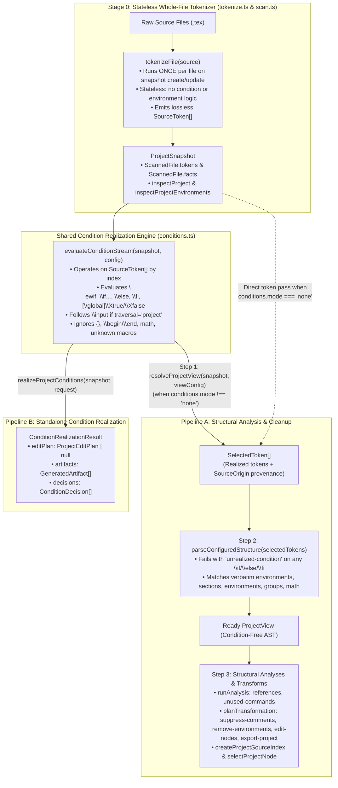

# PrepTeX Core architecture

PrepTeX Core (`@preptex/core@0.5.0`) processes virtual LaTeX projects using **two separate, composable pipelines** built on top of **one stateless whole-file tokenizer**:

1. **Stage 0 — Whole-File Stateless Tokenizer (`tokenizeFile` in `core/src/lib/project/tokenize.ts`)**:
   - Scans each `.tex` file once from offset `0` to `source.length` and emits a flat, lossless array of primitive tokens (`SourceToken[]`).
   - Completely unaware of conditions, `\input` traversal, or environment balance.
2. **Pipeline B — Standalone Condition Realization (`realizeProjectConditions` in `core/src/lib/project/conditions.ts`)**:
   - Consumes `SourceToken[]` by index and evaluates **only** conditional constructs (`\newif`, `\if...`, `\else`, `\fi`, `\Xtrue`, `\Xfalse`, `\global\Xtrue`, `\global\Xfalse`, and optional `\input` traversal to propagate condition state across files).
   - **Ignores all other LaTeX constructs** (brace groups `{}`, `\begin`/`\end` environments, math `$`, sections, and ordinary user macros).
   - Outputs both a checked in-place `ProjectEditPlan` (removing condition commands and inactive branches) and realized condition-free `GeneratedArtifact[]` files.
3. **Pipeline A — Structural View, Analytics, and Transformations (`resolveProjectView` $\rightarrow$ `parseConfiguredStructure` $\rightarrow$ `runAnalysis` / `planTransformation`)**:
   - **Step 1 (View Preprocessor)**: Uses the shared condition realization engine (`evaluateConditionStream`) when `conditions.mode !== 'none'`, or passes tokens directly when `conditions.mode === 'none'`, producing a condition-free `SelectedToken[]` stream with `SourceOrigin` provenance back to the original source files.
   - **Step 2 (Condition-Free AST Parser)**: Builds the structural AST (`ConfiguredNode`: `root | section | command | environment | argument | group | math | token`) from `SelectedToken[]` using built-in, auto-inferred (`\newcommand`/`\def`), and caller-supplied `customCommands` signatures. **Blocks with `reason.code === 'unrealized-condition'` if any unrealized condition token is encountered.**
   - **Step 3 (Views, Catalogs, Metadata & Transforms)**: Exposes `buildCoarseViewTree`, `inspectProjectCatalog`, `extractProjectMetadata`, analyses (`references`, `unused-commands`), single-operation transforms (`suppress-comments`, `remove-environments`, `edit-nodes`, `refactor-symbols`, `export-project`), and composable multi-step pipelines (`planCompositeTransformation` / `compose-transformations`).

---

## The 6 Non-Negotiable Invariants

| ID        | Invariant                                           | Verification Rule                                                                                                                                                                                                                                                                                |
| :-------- | :-------------------------------------------------- | :----------------------------------------------------------------------------------------------------------------------------------------------------------------------------------------------------------------------------------------------------------------------------------------------- |
| **INV-1** | **Single Stateless Tokenizer**                      | `tokenizeFile(source)` runs **once per file** when creating or updating a `ProjectSnapshot`. It takes only `(source: string)` and emits primitive tokens (`comment`, `space`, `command`, `open`, `close`, `math`, `text`).                                                                       |
| **INV-2** | **Lossless Token Stream & Zero Re-Lexing**          | `file.tokens.map(t => t.value).join('') === file.source` for every file. Downstream modules (`scan`, `conditions`, `view`, `structure`, `environments`, `transformation`) operate on `file.tokens` by index rather than re-lexing raw source strings.                                            |
| **INV-3** | **Condition Realizer Ignores Non-Condition Syntax** | `realizeProjectConditions` succeeds (`status: 'ready'`) even when active or inactive branches contain unbalanced `{`, mismatched `\begin{foo}...\end{bar}`, unclosed `$`, or unknown macros `\mycmd{...}`.                                                                                       |
| **INV-4** | **AST Parser Rejects Unrealized Conditions**        | `parseConfiguredStructure` expects **zero** condition tokens. Encountering `\newif`, `\if...`, `\else`, `\fi`, or a declared boolean setter `\Xtrue`/`\Xfalse` outside comments/verbatim/opaque regions immediately stops with `status: 'blocked'` and `reason.code === 'unrealized-condition'`. |
| **INV-5** | **Single Shared Condition Realizer**                | Both Pipeline B (`realizeProjectConditions`) and Step 1 of Pipeline A (`resolveProjectView`) execute the exact same condition evaluation engine (`evaluateConditionStream`).                                                                                                                     |
| **INV-6** | **Realized-Only Structural Operations**             | Structural analyses (`references`, `unused-commands`) and transforms (`suppress-comments`, `remove-environments`, `edit-nodes`, `export-project`) operate on the realized `ProjectView` (`target: 'selected'` or `'artifact'`).                                                                  |

---

## System context and data flow

---

## Repository components

| Component                                | Responsibility                                                                                                          |
| :--------------------------------------- | :---------------------------------------------------------------------------------------------------------------------- |
| `core/src/index.ts`                      | Single public package boundary exporting all types and operations                                                       |
| `core/src/api-types.ts`                  | Base primitive contracts (`ProjectFilePath`, `MathDelimiter`, `SourceRange`, `SourceFile`)                              |
| `core/src/project-types.ts`              | Public readonly contracts for snapshots, tokens, condition realization, views, AST nodes, analyses, and transformations |
| `core/src/node-types.ts`                 | Public readonly contracts for source interval indexing, environment inventories, and node selections/edits              |
| `core/src/errors.ts`                     | `PrepTexError`, `PrepTexErrorCode`, and `ProjectOperationError`                                                         |
| `core/src/lib/project/tokenize.ts`       | Stage 0 stateless whole-file tokenizer (`tokenizeFile`) and token-cursor helpers                                        |
| `core/src/lib/project/scan.ts`           | Token-index syntax fact scanner (`scanFile`) for definitions, uses, labels, refs, inputs, and condition facts           |
| `core/src/lib/project/snapshot.ts`       | `createProjectSnapshot`, `updateProjectSnapshot`, and `inspectProject`                                                  |
| `core/src/lib/project/conditions.ts`     | Shared condition evaluation engine (`evaluateConditionStream`) and Pipeline B (`realizeProjectConditions`)              |
| `core/src/lib/project/view.ts`           | Pipeline A Step 1 view preprocessor (`resolveProjectView`)                                                              |
| `core/src/lib/project/structure.ts`      | Pipeline A Step 2 condition-free structural AST parser (`parseConfiguredStructure`)                                     |
| `core/src/lib/project/analysis.ts`       | `indexProjectView` and `runAnalysis` (`references`, `unused-commands`)                                                  |
| `core/src/lib/project/operations.ts`     | `projectOperations` registry, `checkOperationCapability`, and request normalization                                     |
| `core/src/lib/project/transformation.ts` | `planTransformation`, `validateProjectEditPlan`, and `applyProjectEdits`                                                |
| `core/src/lib/project/emission.ts`       | Lexical join repair, token boundary safety, and artifact provenance mapping                                             |
| `core/src/lib/project/environments.ts`   | `inspectProjectEnvironments`, `getSelectedEnvironment`, and binary-searched token delimiter resolution                  |
| `core/src/lib/project/source-index.ts`   | `createProjectSourceIndex`, `lookupProjectSource`, and `sourceOffsetAt`                                                 |
| `core/src/lib/project/selection.ts`      | `selectProjectNode` and `getSelectedNode`                                                                               |
| `core/src/lib/project/node-edits.ts`     | Selected-node removal, renaming (`rename-environment`, `rename-command`, `rename-section`), unwrapping, and wrapping    |
| `core/src/lib/project/coarse-tree.ts`    | Structural outline builder (`buildCoarseViewTree`) projecting sections, environments, and commands with argument nodes  |
| `core/src/lib/project/catalog.ts`        | Aggregated symbol catalog (`inspectProjectCatalog`) for commands, environments, conditions, labels, and citations       |
| `core/src/lib/project/metadata.ts`       | Document metadata extractor (`extractProjectMetadata`) for `title`, `author`, `date`, `abstract`, and helpers           |
| `core/src/lib/project/refactor.ts`       | Global symbol refactoring and metadata editing (`refactor-symbols`) across source and projected views                   |
| `core/src/lib/project/composite.ts`      | Composable multi-step transformation pipeline (`planCompositeTransformation` / `compose-transformations`)               |
| `core/src/lib/project/pipeline.ts`       | `runProjectPipeline` end-to-end composition                                                                             |
| `cli/`                                   | Node.js CLI adapter (`inventory`, `analyze`, `transform`, `ast`) using only `@preptex/core`                             |
| `docs/api/`                              | TypeDoc Markdown reference generated from TSDoc                                                                         |

---

## Identity, mutability, and transport

- All public return values (`ProjectSnapshot`, `ConditionRealizationResult`, `ProjectView`, `AnalysisResult`, `TransformationResult`, `ProjectSourceIndex`, `EnvironmentInventory`) are deeply frozen at runtime (`Object.freeze`) and typed `readonly`.
- Canonical immutable models are tracked in weak sets/maps so repeated in-process calls skip redundant re-validation. Mutable or structured-cloned transports are automatically re-validated and reconstructed from their authoritative source strings and options.
- Snapshot identities (`SnapshotId`), view identities (`ViewId`), and operation result IDs are deterministic 128-bit hashes over normalized inputs, options, and `@preptex/core` version.
- Every `ConfiguredNode` carries exact `origins` (`SourceOrigin[]`) and `location` (`NodeLocation`) mapping back to `(snapshotId, occurrenceId, path, version, range)` in the original source files.

---

## Known limitations

- PrepTeX is a bounded structural tool (`direct-latex-v1`), not a TeX engine; it does not expand arbitrary user macros, evaluate TeX catcodes, load external `.sty`/`.cls` packages, or compile PDFs.
- Primitive TeX conditionals (`\ifnum`, `\ifdim`, `\ifx`, `\ifmmode`, etc.) reached in active document text stop condition evaluation with `'unsupported-condition'`, though primitive conditionals encapsulated inside macro definition bodies (`\newcommand`, `\def`) are preserved intact as opaque definitions when they do not reference document boolean flags.
- Only literal braced `\input{...}` commands are traversed as project file inclusions; `\include`, `\includeonly`, and macro-generated paths report `'unsupported-effect'` or `'dynamic-input'`.
